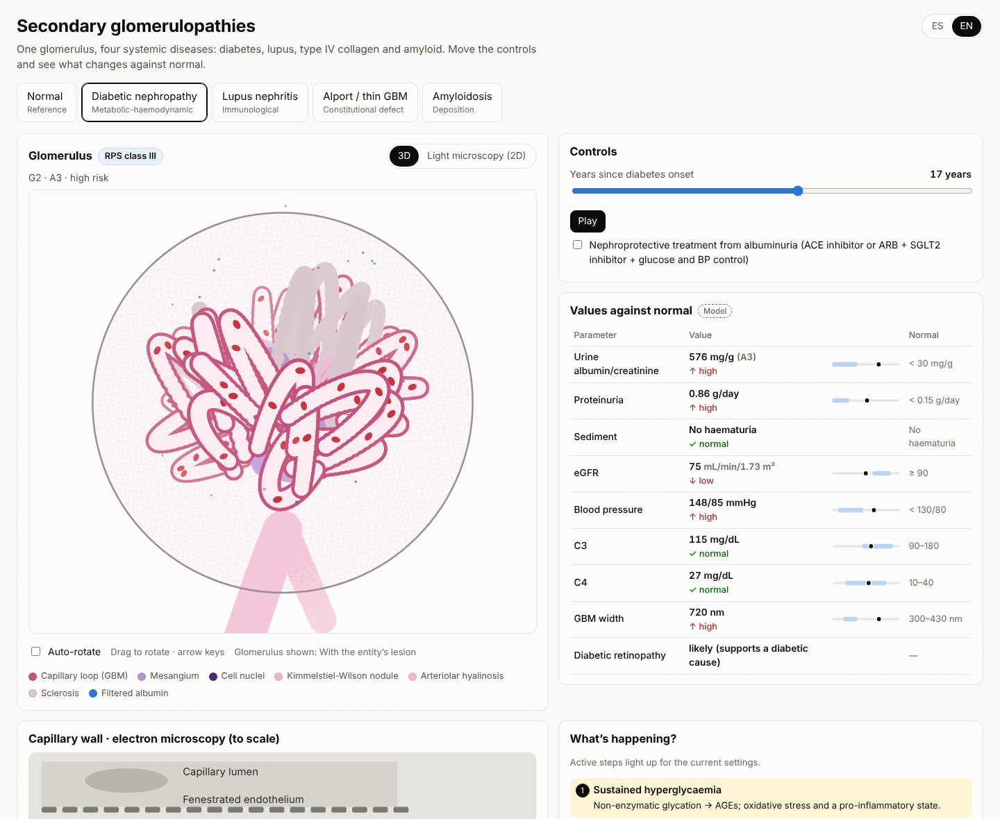

# Secondary glomerulopathies — interactive glomerulus

**Live demo:** https://ferasmed-dev.github.io/secondary-glomerulopathies/ · English: [`?lang=en`](https://ferasmed-dev.github.io/secondary-glomerulopathies/?lang=en)



One glomerulus, four systemic diseases that damage it in four different ways:

| Mechanism | Entity | What you can change |
|---|---|---|
| Metabolic-haemodynamic | **Diabetic kidney disease** (diabetic nephropathy) | Years of diabetes (0–30) and a nephroprotective-treatment toggle |
| Immunological | **Lupus nephritis** | ISN/RPS class I–VI shortcuts, % proliferative glomeruli, % globally sclerosed glomeruli, mesangial hypercellularity, subepithelial deposits |
| Constitutional (type IV collagen) | **Alport syndrome / thin GBM** | Genotype (X-linked male, X-linked carrier, autosomal recessive, heterozygous COL4A3/4), age (0–70), early RAAS blockade |
| Deposition | **Renal amyloidosis** | AL vs AA, amyloid load, Congo red, crossed polarisers and the polariser angle |

The same scene parameters drive every view:

- **3D tuft** (rotate with drag or arrow keys): capillary loops, mesangial stalks, Kimmelstiel-Wilson nodules, crescents, afferent/efferent arterioles with hyalinosis, red cells and albumin leaking into Bowman's space. It is a dependency-free renderer on a 2D canvas.
- **Light-microscopy section (2D SVG)**: mesangial expansion, nodules, wire loops, endocapillary proliferation, crescents, segmental and global sclerosis, amyloid. Under polarised light, each fibril bundle's brightness follows **I ∝ sin²(2(φ − θ))**, so it goes dark at 0°/90° and turns apple-green at 45°.
- **Electron-microscopy capillary wall drawn to scale** (0.11 px/nm), with a dashed outline of the normal 350 nm GBM. It shows deposit location (mesangial / subendothelial / subepithelial), lamina-densa splitting ("basket-weave"), diffuse thinning, foot-process effacement and 8–12 nm amyloid fibrils.
- **Biopsy strip of 20 glomeruli**: shows percentage criteria such as LN class III (< 50 %) vs IV (≥ 50 %), class VI (≥ 90 % sclerosed) and DN class IV (> 50 % global sclerosis). Click a glomerulus to show it in the main view.
- **Values against normal**: albumin/creatinine ratio (with KDIGO A category), proteinuria, sediment, eGFR, BP, C3, C4, GBM width, plus entity-specific values (anti-dsDNA, free λ light chains and κ/λ, CRP, retinopathy, hearing/eye). Each value has a range bar and a ↑/↓/✓ status.
- **¿Qué está pasando? / What's happening?**: the pathogenic chain, with the steps active for the current settings highlighted.
- **Pathology & treatment**: LM / IF / EM findings and stage-appropriate treatment.
- **Natural history** (diabetic nephropathy and Alport): eGFR and ACR curves with and without treatment, a "now" marker, milestones, crosshair tooltip and a table view.

Bilingual: Spanish (default, Castilian medical terminology) and English. The switch sits top-right, and you can also use `?lang=es|en`. The choice is remembered.

## Curriculum fit

For students and teachers at **any Spanish medical faculty**. The topic belongs to the common core defined by Orden ECI/332/2008:

- **Module III — Formación clínica humana**: Nefrología / Patología médica (renal involvement in systemic disease, glomerular disease), with links to Reumatología (SLE), Endocrinología (diabetes complications) and Anatomía patológica.
- **Module I — Morfología, estructura y función**: histology of the glomerular filtration barrier; type IV collagen genetics (Genética médica).
- **MIR relevance: high.** It covers albuminuria categories, the most characteristic vs most frequent vs most specific lesion of DN, ISN/RPS classes (class IV = worst prognosis), complement patterns (lupus vs post-infectious GN), Alport inheritance and post-transplant anti-GBM disease, and AA vs AL amyloidosis with Congo red.

Topic metadata for catalogues: [`curriculum.json`](curriculum.json).

## For teachers

Every scenario has a deep link you can project or share. Add `&lang=en` for English.

| Scenario | Link |
|---|---|
| Normal glomerulus | `?preset=normal` |
| DM, 2 y: hyperfiltration | `?preset=dn-hyperfiltration` |
| DM, 11 y: albuminuria A2 (class IIa) | `?preset=dn-moderate-albuminuria` |
| DM, 17 y: Kimmelstiel-Wilson (class III) | `?preset=dn-kimmelstiel-wilson` |
| DM, 25 y: kidney failure (class IV) | `?preset=dn-advanced` |
| DM, 17 y, treated from albuminuria | `?preset=dn-treated` |
| Lupus nephritis class I … VI | `?preset=ln-class-1` … `?preset=ln-class-6` |
| Lupus nephritis class IV + V | `?preset=ln-class-4-5` |
| X-linked Alport, boy aged 8 | `?preset=alport-xl-boy` |
| X-linked Alport, man aged 24 | `?preset=alport-xl-man` |
| Same patient with early ACE inhibitor | `?preset=alport-xl-treated` |
| X-linked carrier woman, 45 | `?preset=alport-carrier-woman` |
| Autosomal recessive Alport, 16 | `?preset=alport-ar` |
| Thin GBM (heterozygous COL4A3/4) | `?preset=alport-thin-gbm` |
| AA amyloidosis (rheumatoid arthritis) | `?preset=amyloid-aa-ra` |
| AL amyloidosis (λ) | `?preset=amyloid-al-lambda` |
| Congo red under polarised light | `?preset=amyloid-congo-polarized` |

Example: `https://ferasmed-dev.github.io/secondary-glomerulopathies/?preset=ln-class-4&lang=en`

Suggested uses: drag the LN proliferation slider across 50 % to see class III become IV in the biopsy strip; press **Play** in diabetic nephropathy and watch the classes, albuminuria categories and milestones appear in order; rotate the polariser and ask why the birefringence disappears every 90°.

## Model

All logic lives in [`src/model.js`](src/model.js) as pure functions. The UI only draws `snapshot(state)`. Values tagged **Modelo / Model** in the app are teaching simplifications.

### Diabetic kidney disease (time-driven, `dnCourse`)

Integrated with Δt = 0.05 y:

- Untreated albuminuria: `ACR(t) = 8 · exp(k·(t − 4))` mg/g for t > 4, with k = ln10/7, capped at 5 000. This gives **A2 at ~8 y and A3 at ~15 y**.
- Filtering capacity: `dCap/dt = −(0.7 + 10 · ACR/(ACR + 700))` mL/min/y.
- Hyperfiltration factor: `H = 0.28 · (1 − e^(−t/1.5)) · clamp((Cap − 60)/40)`, and `eGFR = Cap · (1 + H)`.
- Treatment (RAAS blockade + SGLT2i + glucose/BP control) starts when ACR first reaches 30. On starting, ACR is multiplied by 0.55 and then grows at 0.12/y. Residual hyperfiltration falls to 65 %, which produces the expected **early eGFR dip (≈ 7 %, < 30 %)**. The loss rate is multiplied by 0.65 and structural lesions progress at half speed.
- Structure: GBM = 350 + 22·t nm (max 900); mesangial index = 0.06·(t − 4); hyalinosis indices for afferent and efferent arterioles; KW nodules once the mesangial index ≥ 0.65; fraction globally sclerosed = 1.05·(100 − Cap)/100.
- RPS 2010 class (`classifyDN`): I = GBM > 430 nm (♂) / > 395 nm (♀); IIa/IIb = mild/severe mesangial expansion; III = ≥ 1 KW nodule; IV = > 50 % global sclerosis.

Untreated course produced by the model: hyperfiltration peak (eGFR ≈ 120) at 3.6 y → RPS I at 3.7 y → A2 at 8.1 y → class II at 8.2 y → first KW nodule at 14.9 y → A3 at 15.1 y → eGFR < 60 at 18.7 y → class IV at 19.8 y → **eGFR < 15 at 24.1 y (≈ 9 y after A3)**. The overt-phase loss is ≈ 8–10 mL/min/y. With treatment, A2 regresses to A1 for ~5 y, eGFR is 84 instead of 6 at 25 y, and kidney failure is not reached by 30 y.

### Lupus nephritis (`classifyLN`, `lnLabs`)

ISN/RPS 2003 classification, revised 2018:

- VI if ≥ 90 % global sclerosis.
- Otherwise IV if ≥ 50 % of glomeruli have proliferative lesions, III if > 0 and < 50 %, II if mesangial hypercellularity, I if none.
- Subepithelial deposits add "+V" to III/IV, or give pure V.

Labs follow the clinico-pathological correlation (all Modelo):

- proteinuria = (0.12 + 0.25·mes + 4.5·p^1.2 + 4·V)·(1 − s) + 1.5·s g/d
- eGFR = (105 − 70·p^1.5 − 8·V)·(1 − 0.95·s^1.2)
- C3 = 125 − 85·p·(1 − s); C4 = 28 − 26·p·(1 − s)
- anti-dsDNA rises with activity
- red-cell casts when the active proliferative fraction ≥ 0.15

### Alport / thin GBM (`alportAt`)

Typical median course by genotype:

| Genotype | Proteinuria | Hearing loss | Lenticonus | eGFR decline starts | ESKD |
|---|---|---|---|---|---|
| X-linked male (COL4A5) | 7 y | 11 y | 20 y | 12 y | **≈ 25 y** |
| Autosomal recessive (COL4A3/4) | 6 y | 10 y | 18 y | 10 y | **≈ 22 y** |
| X-linked carrier female | 30 y | 45 y | — | 40 y (1.2 mL/min/y) | not in the median course |
| Heterozygous COL4A3/4 (AD / "thin GBM") | — (or 30 y if > 0.5 g/d) | — | — | 40 y (0.5/y) | not in the median course (≈ 72 y if proteinuric) |

Early RAAS blockade multiplies the slope by 0.55. For an X-linked male this delays ESKD from 25.5 to 36 y. GBM ultrastructure: thin in early childhood (≈ 230 nm) → lamellation index rising from 4 to 18 y, with mean width up to ≈ 560 nm and alternating thick and thin segments. Heterozygous COL4A3/4: diffusely thin (≈ 210 nm).

### Amyloidosis (`amyloidLabs`, `congoBirefringence`)

With load L ∈ [0, 1]:

- proteinuria = 0.12 + 9·L^1.3 g/d, with no haematuria
- eGFR = 100 − 70·L²
- low BP: SBP 108 − 12·L
- normal C3/C4
- AL: free λ = 20 + 320·L mg/L, so κ/λ falls
- AA: CRP = 12 + 50·L mg/L

Birefringence: `I = sin²(2(φ − θ))`.

### Parameters

| Parameter | Value | Basis |
|---|---|---|
| Normal GBM width | 300–430 nm (shown 350) | Histology references |
| DN GBM thickening threshold | > 430 nm ♂, > 395 nm ♀ | RPS 2010 (Tervaert) |
| Albuminuria categories | A1 < 30, A2 30–299, A3 ≥ 300 mg/g | KDIGO |
| ACR ↔ proteinuria | ACR 30 ≈ PCR 150, ACR 300 ≈ PCR 500 mg/g | KDIGO equivalences; conversion curve is Modelo |
| Untreated overt DN eGFR loss | ≈ 8–10 mL/min/y | Classic natural history (Mogensen); tuned |
| Early eGFR dip on RAASi/SGLT2i | ≈ 7 % (expected < 30 %) | Guideline teaching; tuned |
| DN rates (ACR growth, GBM 22 nm/y, mesangial index, hyalinosis) | see `DN` in model.js | Tuning assumption |
| LN class boundaries | < 50 % / ≥ 50 % / ≥ 90 % | ISN/RPS 2003, 2018 revision |
| LN labs by class | see `lnLabs` | Clinico-pathological correlation; tuned |
| Alport median ages | see table above | Natural-history cohorts (Jais 2000, 2003); tuned |
| Early RAASi effect in Alport | slope × 0.55 | Gross 2012; tuned |
| C3 / C4 reference | 90–180 / 10–40 mg/dL | Typical lab ranges |
| Free light chains | κ 3.3–19.4, λ 5.7–26.3 mg/L, κ/λ 0.26–1.65 | Serum FLC assay reference |

### Known simplifications

- One representative glomerulus is drawn. Percentages of affected glomeruli live in the biopsy strip.
- Interstitial and tubular lesions are described in text, not drawn.
- DN uses one "typical" patient (sex fixed to male for the RPS threshold). Real courses vary widely, and many patients with type 2 diabetes lose eGFR without much albuminuria (non-albuminuric DKD).
- Lupus labs are a deterministic function of the biopsy picture. In real patients serology and histology often disagree, which is why biopsy is needed.
- Alport courses are medians. Carrier women and heterozygous COL4A3/4 patients range from benign haematuria to kidney failure.
- The 3D view is illustrative, not anatomical reconstruction.

## Expected results per preset

| Preset | Class | ACR (mg/g) | Proteinuria (g/d) | eGFR | BP | C3/C4 | Sediment | GBM (nm) |
|---|---|---|---|---|---|---|---|---|
| normal | — | 6 | 0.08 | 105 | 118/74 | 120/28 | bland | 350 |
| dn-hyperfiltration | — | 8 | 0.11 | 118 | 123/76 | 115/27 | bland | 390 |
| dn-moderate-albuminuria | RPS IIa | 80 | 0.19 | 107 | 131/79 | 115/27 | bland | 590 |
| dn-kimmelstiel-wilson | RPS III | 576 | 0.86 | 75 | 148/85 | 115/27 | bland | 720 |
| dn-advanced | RPS IV | 5 000 | 7.15 | 6 | 172/93 | 115/27 | bland | 900 |
| dn-treated | RPS IIa | 48 | 0.16 | 97 | 121/74 | 115/27 | bland | 630 |
| ln-class-1 | I | 18 | 0.12 | 105 | 118/74 | 125/28 | bland | 360 |
| ln-class-2 | II | 218 | 0.37 | 105 | 118/74 | 125/28 | micro | 360 |
| ln-class-3 | III | 988 | 1.43 | 91 | 130/80 | 101/21 | micro + casts | 360 |
| ln-class-4 | IV | 2 581 | 3.70 | 53 | 147/89 | **60/8** | micro + macro + casts | 360 |
| ln-class-4-5 | IV+V | 5 244 | 7.50 | 46 | 153/92 | 60/8 | micro + macro + casts | 520 |
| ln-class-5 | V | 3 053 | 4.37 | 97 | 124/77 | 125/28 | micro | 520 |
| ln-class-6 | VI | 994 | 1.44 | 11 | 145/85 | 125/28 | bland | 360 |
| alport-xl-boy | X-linked ♂ | 353 | 0.55 | 100 | 112/70 | normal | micro + macro | 320 |
| alport-xl-man | X-linked ♂ | 2 442 | 3.50 | 22 | 142/82 | normal | micro | 560 |
| alport-xl-treated | X-linked ♂ | 1 458 | 2.10 | 57 | 131/76 | normal | micro | 560 |
| alport-carrier-woman | X-linked ♀ | 607 | 0.90 | 94 | 114/71 | normal | micro | 340 |
| alport-ar | AR | 1 951 | 2.80 | 58 | 131/76 | normal | micro | 510 |
| alport-thin-gbm | AD | 9 | 0.11 | 100 | 112/70 | normal | micro | 210 |
| amyloid-aa-ra | AA | 3 321 | 4.75 | 75 | 101/64 | normal | bland | 360 |
| amyloid-al-lambda | AL | 4 042 | 5.78 | 66 | 100/64 | normal | bland | 360 |
| amyloid-congo-polarized | AA | 3 321 | 4.75 | 75 | 101/64 | normal | bland | 360 |

## Where this goes beyond (or corrects) common lecture notes

- **eGFR loss in overt diabetic nephropathy is ~10 mL/min per *year*** untreated, not 1 mL/min per year (that is normal ageing). This is consistent with reaching kidney failure ~10 years after overt nephropathy.
- **Persistent albuminuria** = 2 of 3 samples positive over 3–6 months (KDIGO). "Microalbuminuria" is now called *moderately increased albuminuria (A2)*.
- **Glycaemic target is individualised** (HbA1c < 6.5 % to < 8 %, KDIGO 2022). **Finerenone** is recommended in type 2 diabetes with albuminuria ≥ 30 mg/g, eGFR ≥ 25 and normal K⁺. SGLT2 inhibitors are used down to eGFR ≥ 20.
- **ISN/RPS 2018** dropped the IV-S / IV-G subdivision and added modified NIH activity/chronicity indices. Class II can show microscopic haematuria.
- **Lupus nephritis treatment per KDIGO 2024**: glucocorticoids + mycophenolate or low-dose IV cyclophosphamide; triple therapy adding belimumab or voclosporin; obinutuzumab approved in 2025 on top of standard therapy.
- **Lupus classification criteria**: the "≥ 4 criteria, 96 %" rule is SLICC 2012. Current classification is EULAR/ACR 2019 (ANA ≥ 1:80 entry criterion plus weighted domains ≥ 10). The app does not compute it.
- **Alport EM** shows *irregular* thickening alternating with thinning, with a split, layered lamina densa ("basket-weave"). Pure diffuse thinning is the heterozygous COL4A3/4 / "thin GBM" picture. Under the 2018 classification (Kashtan et al.), heterozygous COL4A3/4 is considered part of the autosomal-dominant Alport spectrum, and genetic series find it more common than the classic 5 %.
- **Amyloidosis**: in high-income countries **AL** is now the commonest systemic type. AA predominates where chronic infection/inflammation is poorly controlled. EM fibrils (8–12 nm, non-branching) and κ/λ light-chain testing are added.

## Layout

```
index.html           page shell
src/model.js         pure model: classifiers, courses, labs, snapshot(), presets
src/i18n.js          ES + EN strings (dynamic text as functions of the snapshot)
src/ui.js            DOM, controls, rendering; window.__sim for automated checks
src/scene3d.js       dependency-free 3D renderer (canvas)
src/draw2d.js        light-microscopy SVG, EM capillary wall, biopsy strip
src/charts.js        SVG line charts, table view, bullet bars
src/styles.css       light/dark, responsive
tests/model.test.js  node:test suite
curriculum.json      topic metadata
```

## Run locally

```bash
python3 -m http.server 8000
# open http://localhost:8000/  (or ?preset=ln-class-4&lang=en)
```

No build step, no dependencies, no CDN.

## Tests

```bash
npm test     # = node --test
```

There are 33 tests covering:

- KDIGO categories and the risk grid
- ACR ↔ proteinuria conversion
- DN sequence and timing, RPS class order, treatment effect and the < 30 % dip
- ISN/RPS boundaries (49 % vs 50 %, +V, VI) and lab direction by class
- Alport timing by genotype, thin vs lamellated GBM, effect of RAAS blockade
- Congo red extinction at 0°/90° and maximum at 45°
- Amyloid labs
- Every preset
- Extreme inputs (no NaN or negatives) and purity

CI runs the suite on every push (`.github/workflows/test.yml`).

## Deploy (GitHub Pages)

Settings → Pages → Deploy from a branch → `main` / `(root)`. The site appears at `https://ferasmed-dev.github.io/secondary-glomerulopathies/`. `.nojekyll` is included.

## References

- Tervaert TWC et al. Pathologic classification of diabetic nephropathy. *J Am Soc Nephrol* 2010;21:556-63.
- KDIGO 2022 Clinical Practice Guideline for Diabetes Management in CKD. *Kidney Int* 2022;102(5S):S1-S127.
- KDIGO 2024 Clinical Practice Guideline for the Evaluation and Management of CKD. *Kidney Int* 2024;105(4S).
- KDIGO 2021 Clinical Practice Guideline for the Management of Blood Pressure in CKD. *Kidney Int* 2021;99(3S).
- Mogensen CE, Christensen CK, Vittinghus E. The stages in diabetic renal disease. *Diabetes* 1983;32(Suppl 2):64-78.
- Weening JJ et al. The classification of glomerulonephritis in SLE revisited. *J Am Soc Nephrol* 2004;15:241-50.
- Bajema IM et al. Revision of the ISN/RPS classification for lupus nephritis (2018). *Kidney Int* 2018;93:789-96.
- KDIGO 2024 Clinical Practice Guideline for the Management of Lupus Nephritis. *Kidney Int* 2024;105(1S):S1-S69.
- Furie RA et al. Efficacy and safety of obinutuzumab in active lupus nephritis (REGENCY). *N Engl J Med* 2025.
- Aringer M et al. 2019 EULAR/ACR classification criteria for SLE. *Arthritis Rheumatol* 2019;71:1400-12.
- Jais JP et al. X-linked Alport syndrome: natural history in 195 families. *J Am Soc Nephrol* 2000;11:649-57; and in 323 heterozygous females, 2003;14:2603-10.
- Kashtan CE et al. Alport syndrome: a unified classification of genetic disorders of collagen IV α345. *Kidney Int* 2018;93:1045-51.
- Gross O et al. Early angiotensin-converting enzyme inhibition in Alport syndrome delays renal failure. *Kidney Int* 2012;81:494-501.
- Gertz MA, Dispenzieri A. Systemic amyloidosis recognition, prognosis, and therapy. *JAMA* 2020;324:79-89.
- Kastritis E et al. Daratumumab-based treatment for AL amyloidosis (ANDROMEDA). *N Engl J Med* 2021;385:46-58.
- Jennette JC et al. *Heptinstall's Pathology of the Kidney*, 7th ed. (filtration barrier, EM findings).

---

**Herramienta docente · no apta para uso clínico** — Teaching tool · not for clinical use.

MIT © 2026 Feras Elhissi
